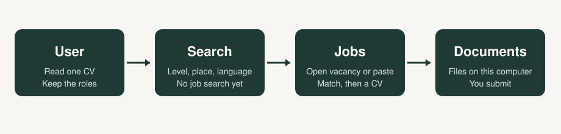

# Career Copilot

Local tool that reads one CV, suggests roles, searches open jobs, and shows how the profile matches a vacancy. It can draft a CV and, when the posting asks, a cover letter. The person reviews every file and submits the application. The program does not apply to jobs.



## Flow

The page that opens has four steps. Each step waits for the person.

1. **User.** Upload one DOCX or one single-column text PDF. Python reads it on this computer. A scanned page or a multi-column PDF is refused. Grok suggests up to eight roles. The person keeps, drops, or types roles. Save stores the roles. The CV text stays in a local file that git ignores.
2. **Search.** This page does not look for jobs. The person can set experience level, employment type, workplace, country, city, and language. An empty field is not a filter. Continue opens Jobs only after the roles are saved.
3. **Jobs.** Automatic search asks the local Grok login for links to open vacancies, then Python opens those pages. The person can also paste a posting or one public link. The result shows what matches, what might match, and what is missing. Yes or No on a possible line is saved on this computer and does not change the CV. Generate CV writes one PDF for that job. Only the summary and the technical skills may change, and only with facts already in the CV. A cover letter is written only when the posting asks for one.
4. **Documents.** Lists the CVs written on this computer and whether the person said they applied. Nothing is submitted.

`SPEC.md` is the contract for these four pages. `docs/ARCHITECTURE.md` describes the running program. `docs/MATCH.md` describes how a vacancy is scored. An older command-line path remains in the code and is not on the menu.

## Run

Python 3.11 or newer.

```powershell
python -m venv .venv
.\.venv\Scripts\python.exe -m pip install -e .
.\.venv\Scripts\career-copilot.exe ui
```

Open http://127.0.0.1:8501. The page stays on this computer. Sign in to the local `grok` program before using role suggestions or job search. Do not set an API key for that path.

## Pages

1. User. Upload one DOCX or single-column text PDF. Keep, drop, or add roles.
2. Search. Choose level, employment, workplace, place, and language. Empty fields are not filters.
3. Jobs. Search open vacancies or paste a posting. The match lists what fits, what might fit, and what is missing.
4. Documents. List CVs written on this computer and whether the person said they applied.

Saved profiles, CVs, and generated files stay outside git.

## Tests

```powershell
.\.venv\Scripts\python.exe -m pytest
```
